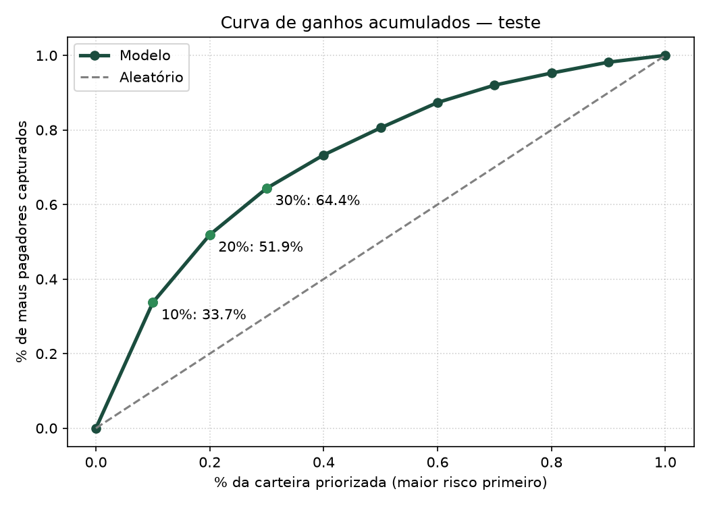
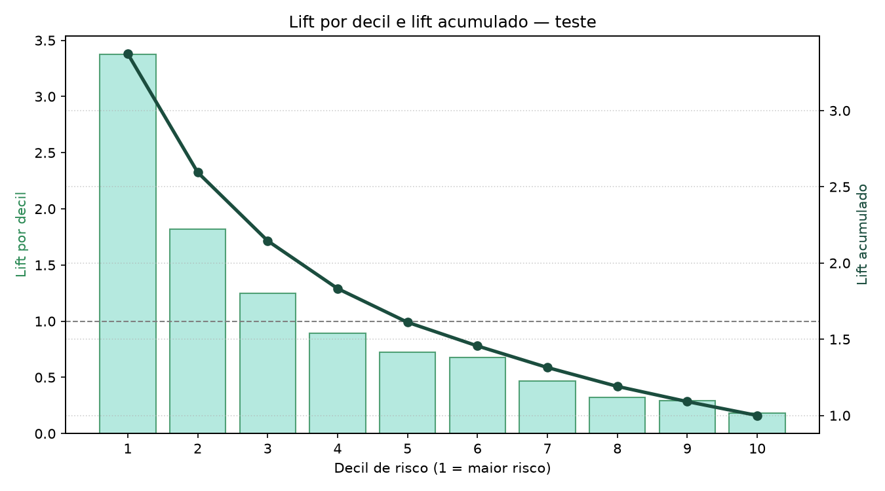
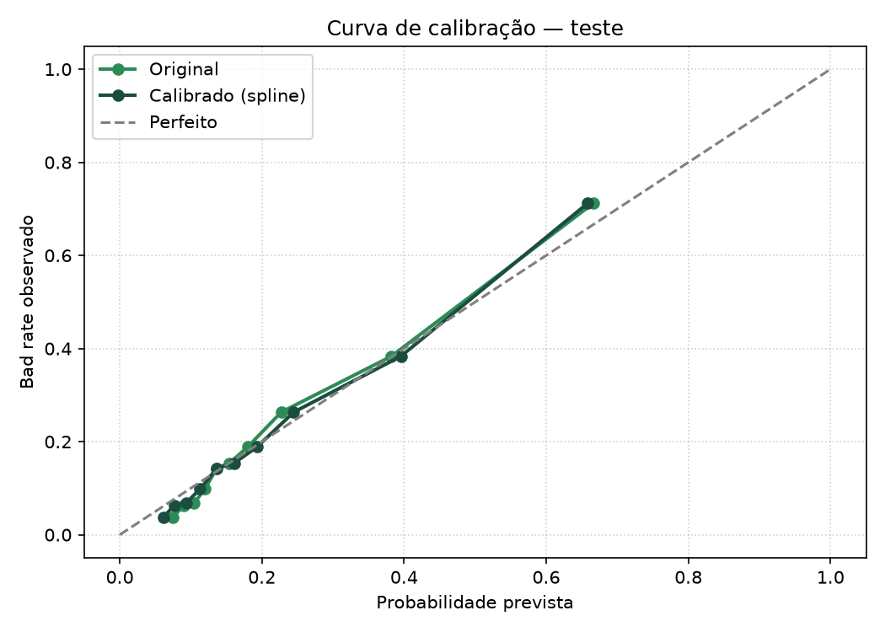
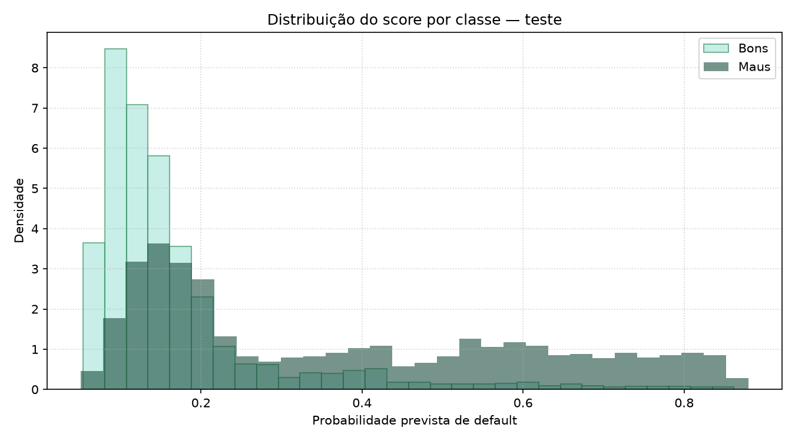

# Credit Risk Scorecard — do dado bruto à decisão de crédito

> Pipeline completo e auditável de risco de crédito: engenharia de atributos, WoE/IV, regressão logística, calibração de probabilidades e avaliação orientada a negócio.

**Resultado no teste out-of-time:** AUC **0,790** · KS **0,438** · Gini **0,581**  
**Impacto de negócio:** os **20%** dos clientes com maior risco concentram **51,9%** dos defaults, com lift de **2,59×**.

---

## Por que este projeto chama atenção

Este não é apenas um notebook de modelo. É um **case end-to-end de risco de crédito**, construído com preocupações reais de mesa de crédito, auditoria e model risk management:

- separação temporal de treino, validação e teste/OOT;
- tratamento ajustado apenas no treino, sem vazamento de dados;
- binning supervisionado com `optbinning`, IV, WoE e monotonicidade;
- seleção de variáveis com correlação, VIF e stepwise estatístico;
- regressão logística com `statsmodels.formula.api`;
- calibração de probabilidades com spline;
- avaliação de negócio com gains, lift, calibração e tabela de decisão;
- artefatos reprodutíveis para auditoria, monitoramento e uso do modelo;
- documentação de agentes para replicar a arquitetura em crédito PJ, com geografia e CNAE.

---

## Resultados principais

### Desempenho do modelo

| Base | Clientes | Bad rate | AUC | KS | Gini |
|---|---:|---:|---:|---:|---:|
| Treino | 18.000 | 23,1% | 0,768 | 0,407 | 0,537 |
| Validação | 6.000 | 20,3% | 0,778 | 0,419 | 0,556 |
| Teste/OOT | 6.000 | 21,1% | **0,790** | **0,438** | **0,581** |

### Captura de risco no teste

| Carteira priorizada | Maus capturados | Lift acumulado |
|---|---:|---:|
| Top 10% | 33,7% | 3,37× |
| Top 20% | 51,9% | 2,59× |
| Top 30% | 64,4% | 2,15× |
| Top 50% | 80,6% | 1,61× |

### Calibração de probabilidades

| Versão | Brier | Log loss | ECE | AUC |
|---|---:|---:|---:|---:|
| Original | 0,1291 | 0,4156 | 0,0222 | 0,7906 |
| Calibrada com spline | **0,1287** | **0,4135** | **0,0182** | 0,7906 |

A calibração não altera ranking, lift ou gains. Ela melhora a confiança nas probabilidades, o que importa para perda esperada, provisão, precificação e política de limite.

---

## Visualizações

### Curva de ganhos acumulados



### Lift por decil



### Calibração antes e depois



### Distribuição de score por classe



---

## Pipeline

| Etapa | Notebook | Responsabilidade | Saída |
|---|---|---|---|
| 00 | `00_split_dos_dados.ipynb` | Split temporal e tratamento inicial | `data/01_prata/*_tratado.parquet` |
| 01 | `01_engenharia_atributos.ipynb` | Features financeiras e comportamentais | `data/01_prata/*_fe.parquet` |
| 02 | `02_eda_behavior_score.ipynb` | EDA, IV, monotonicidade e estabilidade | Gráficos e diagnósticos |
| 03 | `03_binning_iv_woe.ipynb` | Binning supervisionado, IV e WoE | `data/02_gold/*_woe.parquet` |
| 04 | `04_selecao_variaveis.ipynb` | IV, correlação e VIF | `variaveis_selecionadas.json` |
| 05 | `05_modelagem_avaliacao.ipynb` | Modelo, stepwise, calibração e avaliação | Modelos, métricas e scores |

O notebook `01_exploracao_dos_dados.ipynb` permanece como análise exploratória de apoio. O `Log_Aula5.ipynb` é uma referência técnica de `optbinning`.

---

## Metodologia

### 1. Split temporal
Separação por safra, preservando a ordem do tempo:

- treino: safras mais antigas;
- validação: safras intermediárias;
- teste/OOT: safras mais recentes.

### 2. Tratamento sem vazamento
Limites de winsorização e regras de negócio são ajustados **somente no treino** e aplicados em treino, validação e teste.

### 3. Engenharia de atributos
Criação de features como:

- `SUM_BILL`, `AVG_BILL`, `MAX_BILL`;
- `SUM_PAY`, `AVG_PAY`, `MAX_PAY`;
- `UTILIZACAO`, `UTIL_MEDIA`, `PCT_PAGAMENTO`;
- `FREQ_ATRASO`, `MAX_ATRASO`;
- `LIMIT_PER_CAPITA`.

### 4. Binning e WoE
Uso de `optbinning` para:

- discretização supervisionada;
- controle de volume mínimo por bin;
- monotonicidade;
- cálculo de IV e WoE;
- transformação consistente de treino, validação e teste.

### 5. Seleção de variáveis
- filtro por IV;
- remoção de redundância com correlação de Spearman;
- VIF nas colunas WoE;
- stepwise backward com `p ≤ 0,05`, ajustado apenas no treino.

### 6. Modelagem
Regressão logística com `statsmodels.formula.api`, escolhida por:

- interpretabilidade;
- auditabilidade;
- aderência a scorecards de crédito;
- facilidade de comunicação para comitê e auditoria.

### 7. Calibração
Comparação entre Platt, Isotonic e Spline. O spline foi escolhido por melhor log loss na validação e por preservar a AUC, com probabilidades mais suaves.

### 8. Avaliação de negócio
Além de AUC/KS/Gini:

- curva de ganhos acumulados;
- lift por decil;
- calibração;
- distribuição de score;
- tabela de decisão;
- resumo de captura de maus.

---

## Variáveis finais do modelo

```text
AGE
PAY_0
PAY_3
PAY_4
PAY_5
PAY_6
PAY_AMT1
PAY_AMT2
PAY_AMT6
MAX_BILL
UTIL_MEDIA
LIMIT_PER_CAPITA
```

O modelo completo tinha 16 variáveis. O stepwise removeu `SUM_BILL`, `PAY_2`, `PAY_AMT3` e `PCT_PAGAMENTO` sem perda material de performance, reduzindo complexidade e melhorando o BIC.

---

## Stack

- **Python 3.12**
- **pandas / numpy** — manipulação e engenharia de dados
- **optbinning** — binning, IV e WoE
- **statsmodels** — regressão logística, stepwise e VIF
- **scikit-learn** — métricas, calibração e validação
- **matplotlib / seaborn** — visualização
- **sweetviz** — EDA automatizada
- **pytest** — testes automatizados
- **ruff** — lint e padronização
- **Jupyter** — notebooks
- **uv** — gestão de dependências

---

## Estrutura do repositório

```text
.
├── data/
│   ├── 00_bronze/        # dados brutos e splits
│   ├── 01_prata/         # dados tratados e com features
│   └── 02_gold/          # WoE, bins, modelos e métricas
├── notebooks/            # pipeline numerado
├── prompts/              # diretrizes de agentes
├── reports/              # gráficos e relatórios
├── src/modelo_credito/   # pacote Python reutilizável
│   ├── config.py         # constantes e colunas
│   ├── data.py           # carga, split e tratamento
│   ├── features.py       # engenharia de atributos
│   ├── eda.py            # WoE, IV e monotonicidade
│   ├── binning.py        # fit/transform do binning
│   ├── selection.py      # IV, correlação e VIF
│   ├── modeling.py       # logística, stepwise e modelo portável
│   ├── evaluation.py     # AUC, KS, Gini, gains e lift
│   ├── calibration.py    # Platt, Isotonic e Spline
│   └── plots.py          # gráficos reutilizáveis
├── tests/                # testes automatizados
├── pyproject.toml
└── README.md
```

### Principais artefatos

```text
data/02_gold/binning_process.pkl
data/02_gold/binning_summary.csv
data/02_gold/variaveis_selecionadas.json
data/02_gold/variaveis_stepwise.json
data/02_gold/modelo_logistico.pkl
data/02_gold/modelo_logistico_portavel.pkl
data/02_gold/calibrador.pkl
data/02_gold/metricas_modelo.csv
data/02_gold/metricas_calibracao_final.csv
data/02_gold/tabela_decisao_teste.csv
data/02_gold/resumo_captura_teste.csv
data/02_gold/scores_teste_calibrado.parquet
```

---

## Pacote Python

A lógica principal do pipeline foi extraída para `src/modelo_credito/`, permitindo reutilização fora dos notebooks.

```python
from modelo_credito.data import compute_treatment_limits, apply_treatment
from modelo_credito.features import create_features
from modelo_credito.binning import build_transformed_dataset, fit_binning_process
from modelo_credito.selection import select_variables
from modelo_credito.modeling import stepwise_logit, save_portable_model
from modelo_credito.evaluation import decision_table, capture_summary
from modelo_credito.calibration import fit_calibrators, apply_calibrator
```

Exemplo de uso:

```python
limites = compute_treatment_limits(treino)
treino_tratado = apply_treatment(treino, limites)
treino_fe = create_features(treino_tratado)

process = fit_binning_process(treino_fe, variaveis, categorical_variables=cat)
treino_woe = build_transformed_dataset(
    process, treino_fe, variaveis, ["ID", "SAFRA"], "default"
)
```

---

## Como executar

### 1. Instalar dependências

```bash
uv sync
```

### 2. Rodar testes e lint

```bash
uv run pytest
uv run ruff check src tests
```

### 3. Abrir o Jupyter

```bash
uv run jupyter lab
```

### 4. Executar os notebooks na ordem

```text
00_split_dos_dados.ipynb
01_engenharia_atributos.ipynb
02_eda_behavior_score.ipynb
03_binning_iv_woe.ipynb
04_selecao_variaveis.ipynb
05_modelagem_avaliacao.ipynb
```

Se as bases em `data/01_prata` já existirem, é possível começar pelo notebook `01`.

---

## Boas práticas aplicadas

- **Sem vazamento de target:** transformações supervisionadas ajustadas apenas no treino.
- **Teste intocável:** nenhuma decisão de modelo, binning ou threshold usa o teste.
- **Reprodutibilidade:** parâmetros, bins, modelos e métricas salvos em disco.
- **Auditabilidade:** bins, WoE, IV e histórico de stepwise documentados.
- **Interpretabilidade:** modelo logístico com WoE e tabela de decisão.
- **Comunicação de negócio:** gains, lift, calibração e captura de maus.
- **Portabilidade:** modelo salvo também em formato independente de `patsy`/`statsmodels`.

---

## O que este projeto demonstra

- construção de pipeline de crédito de ponta a ponta;
- domínio de WoE, IV, binning e scorecards;
- cuidado com vazamento, validação temporal e estabilidade;
- capacidade de traduzir métricas técnicas em impacto de negócio;
- preocupação com auditoria, governança e monitoramento;
- uso consciente de calibração de probabilidades;
- organização de código e artefatos para reprodução;
- empacotamento em biblioteca Python reutilizável e testável;
- testes automatizados e lint com `pytest` e `ruff`;
- documentação de arquitetura para novos contextos, incluindo crédito PJ com geografia e CNAE.

---

## Próximos passos

- modelo challenger com CatBoost e SHAP;
- análise de PSI e estabilidade por safra;
- avaliação de fairness e impacto regulatório de variáveis geográficas;
- scorecard com pontuação por faixa;
- API ou aplicação para scoring;
- adaptação para crédito PJ com hierarquia de município, bairro, CEP e CNAE;
- monitoramento contínuo de performance e calibração.

---

## Referências

A base teórica do projeto está documentada em `artigos_de_referencia/`:

| Artigo | Tema | Por que está no projeto |
|---|---|---|
| [An Introduction to Logistic Regression](artigos_de_referencia/An_Introduction_to_Logistic_Regression_From_Basic_.pdf) | Regressão logística | Fundamenta o modelo interpretável usado no scorecard |
| [Cramér's V](artigos_de_referencia/crammer.pdf) | Associação entre categóricas | Apoia a análise de redundância entre variáveis categóricas |
| [Default of Credit Card Clients — Yeh & Lien (2009)](artigos_de_referencia/DefaultCreditCardClients_yeh_2009.pdf) | Dataset e benchmark | Origem da base e referência para comparação de resultados |
| [Information Value](artigos_de_referencia/IV.pdf) | IV e poder preditivo | Base para o screening univariado e a transformação WoE |

Referências complementares:

- Yeh, I. C., & Lien, C. H. (2009). *The comparisons of data mining techniques for the predictive accuracy of probability of default of credit card clients.*
- Documentação do `optbinning`.

---

## Autor

**Evaldo**  
Cientista de Dados

Contato: `evaldoazeredoc@gmail.com`
